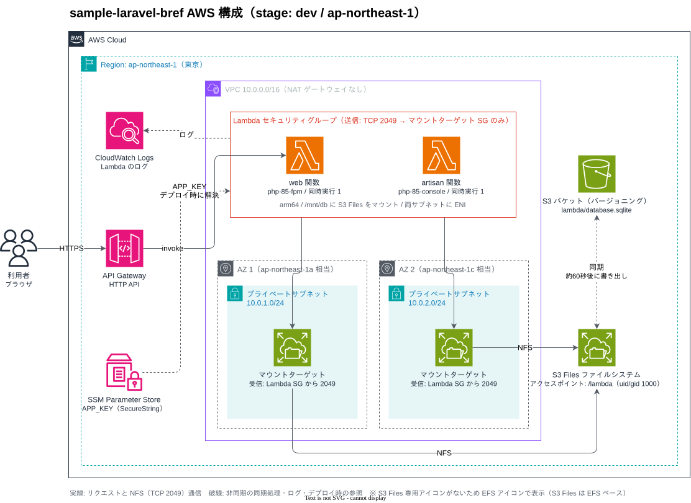

# sample-laravel-bref

Laravel を [Bref](https://bref.sh/) で AWS Lambda にデプロイする構成の検証用リポジトリ。データベースには、S3 上の SQLite を [S3 Files](https://docs.aws.amazon.com/lambda/latest/dg/configuration-filesystem-s3files.html) でマウントして使う。

- Laravel 13 / PHP 8.5 / Bref 3（`bref/laravel-bridge`）、Serverless Framework（osls）
- 検証用のアプリ: 簡易メモ（一覧・追加・削除）
- ローカルでも、AWS と同じ Bref の Lambda ランタイムイメージを docker compose で動かす



## 必要なもの

| 用途 | ツール |
|---|---|
| ローカルで動かす・テストする | Docker、PHP 8.3 以上（CI と Lambda のランタイムは 8.5）、Composer、jq、curl |
| AWS にデプロイする | 上記に加えて AWS CLI v2、gh（初回の準備だけ） |

Node.js はホストに要らない（Serverless Framework と Playwright はコンテナで動かす）。

## ローカルで動かす

初回だけ、依存関係と設定を用意する。

```bash
composer install
```

```bash
cp .env.example .env
```

```bash
php artisan key:generate
```

Linux では、コンテナ（uid 993）から DB に書き込めるようにしておく。

```bash
mkdir -p .docker-data/db && chmod 777 .docker-data/db
```

起動して、マイグレーションを流す。

```bash
docker compose up -d
```

```bash
bin/local-artisan "migrate --force"
```

http://localhost:8000/ を開く。止めるときは `docker compose down`（データは `.docker-data/db/` に残る）。

仕組み（compose の構成、Lambda に近づけるための設定、artisan の実行のしかた）は [docs/local-development.md](docs/local-development.md) を参照。

## よく使うコマンド

### ローカル

| やりたいこと | コマンド |
|---|---|
| 起動する / 止める | `docker compose up -d` / `docker compose down` |
| artisan コマンドを実行する | `bin/local-artisan "migrate:status"` |
| ログを見る | `docker compose logs -f web` |

### テストとコード品質

| やりたいこと | コマンド |
|---|---|
| コード品質チェック（必須） | `composer lint`（自動で直す: `composer lint:fix`） |
| Feature テスト | `php artisan test` |
| E2E テスト（ローカルのスタックを起動して実行） | `bin/e2e` |
| E2E テストを録画する | `bin/e2e --video` |
| E2E テストを UI モードで見る | `bin/e2e --ui`（http://127.0.0.1:9323/ を開く） |
| デプロイした環境に E2E テスト | `bin/e2e https://<api-id>.execute-api.ap-northeast-1.amazonaws.com` |

変更は `composer lint` と `php artisan test` を通してから PR にする。CI でも同じチェックと E2E テストが走る。

### AWS

| やりたいこと | コマンド |
|---|---|
| ログインする | `aws sso login --profile takyafumin` |
| デプロイとマイグレーション | `bin/aws-release dev` |
| デプロイだけ | `bin/deploy dev` |
| artisan コマンドを実行する | `bin/serverless bref:cli --stage dev --args="migrate:status"` |
| テンプレートを検証する | `bin/cfn-lint dev` |
| ログを見る | `aws logs tail /aws/lambda/sample-laravel-bref-dev-web --follow --profile takyafumin --region ap-northeast-1` |
| 削除する | `bin/aws-remove dev` |

AWS プロファイルは既定で `takyafumin`（SSO）。別のプロファイルを使うときは `AWS_PROFILE` で上書きする。

## AWS にデプロイする

先に「[ローカルで動かす](#ローカルで動かす)」の初回の準備（`composer install`、`.env`、`php artisan key:generate`）を済ませておく。デプロイのスクリプトも、Serverless Framework を docker compose で動かすので `.env` の APP_KEY が要る（デプロイ先の APP_KEY は SSM のものを使う）。

### 初回の準備（AWS アカウントごとに1回）

```bash
aws sso login --profile takyafumin
```

```bash
bin/aws-bootstrap-github-deploy
```

```bash
bin/aws-put-app-key dev
```

1つ目はデプロイ用の IAM ロールを作り、2つ目は APP_KEY を SSM Parameter Store に作る。GitHub Actions からデプロイするときは、GitHub の environment `dev` と変数 `AWS_DEPLOY_ROLE_ARN` も設定する（[docs/github-actions-deploy.md の「初回の準備」](docs/github-actions-deploy.md#4-初回の準備)）。

### GitHub Actions からデプロイする

Actions → **Deploy** → **Run workflow** で、ステージを選んで実行する（main ブランチからだけ）。デプロイ、未実行のマイグレーション、デプロイした環境への E2E テストまでを行う。

### 手元からデプロイする

```bash
bin/aws-release dev
```

未実行のマイグレーションがあれば、メンテナンスモードでデプロイしてから流す。手順の詳細と個別のコマンドは [docs/aws-deploy.md](docs/aws-deploy.md) を参照。

## ドキュメント

| ドキュメント | 内容 |
|---|---|
| [docs/local-development.md](docs/local-development.md) | ローカル環境の仕組み、artisan の実行、ログ・停止・データ |
| [docs/testing.md](docs/testing.md) | テストの実行（Feature テスト、E2E テスト、録画と UI モード、注意点） |
| [docs/test-cases.md](docs/test-cases.md) | テストケースの一覧と、自動テストで確認していないこと |
| [docs/code-quality.md](docs/code-quality.md) | コード品質チェックのツールと実行方法 |
| [docs/aws-architecture.md](docs/aws-architecture.md) | AWS 構成の設計（リソース、ネットワーク、IAM、データ、設計判断、制約） |
| [docs/aws-deploy.md](docs/aws-deploy.md) | 手元からの AWS デプロイ（準備、デプロイ、マイグレーション、後片付け） |
| [docs/github-actions-deploy.md](docs/github-actions-deploy.md) | GitHub Actions からのデプロイ（仕組み、初回の準備、権限の設計、うまくいかないとき） |

## 検証の経緯

| Issue | 内容 |
|---|---|
| [#1](https://github.com/takyafumin/sample-laravel-bref/issues/1) | ローカルで Bref のランタイムを動かす |
| [#2](https://github.com/takyafumin/sample-laravel-bref/issues/2) | AWS にデプロイする（S3 Files 上の SQLite） |
| [#7](https://github.com/takyafumin/sample-laravel-bref/issues/7) | Playwright の E2E テスト |
| [#9](https://github.com/takyafumin/sample-laravel-bref/issues/9) | GitHub Actions からのデプロイ |
| [#13](https://github.com/takyafumin/sample-laravel-bref/issues/13) | E2E テストの録画と UI モード |
