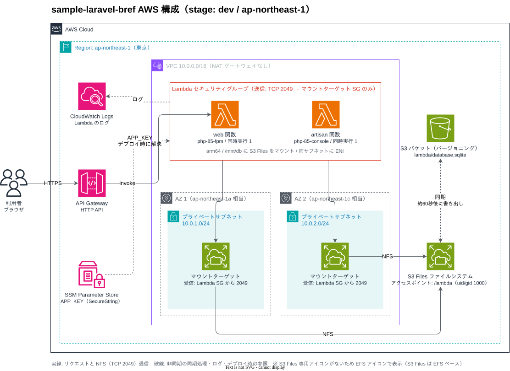

# AWS 構成設計書

Laravel を Bref で AWS Lambda にデプロイし、データベースには S3 上の SQLite を使う構成の設計書。
検証の経緯は [#2](https://github.com/takyafumin/sample-laravel-bref/issues/2) を参照。

- 定義: [serverless.yml](../serverless.yml)（Serverless Framework / osls + Bref）
- 手順: [README.md](../README.md) の「AWS デプロイ」

## 1. 構成図

[architecture.drawio.svg](architecture.drawio.svg) は draw.io のデータを埋め込んだ SVG。draw.io（デスクトップ版、または app.diagrams.net）でそのまま開いて編集できる。

### 処理の流れ

1. 利用者のブラウザが API Gateway（HTTP API）に HTTPS でリクエストする。
2. API Gateway が web 関数（Bref FPM ランタイム）を呼び出す。
3. web 関数は `/mnt/db/database.sqlite` を読み書きする。`/mnt/db` には S3 Files のファイルシステムがマウントされていて、通信は各サブネットのマウントターゲット経由の NFS（TCP 2049）で行う。
4. S3 Files は、ファイルシステムへの変更を S3 バケットに書き出す（書き込みが60秒止まってから）。S3 側の変更もファイルシステムに取り込む。
5. マイグレーションなどの artisan コマンドは、artisan 関数（Bref console ランタイム）で実行する。artisan 関数も同じファイルシステムをマウントする。

## 2. リソース一覧

CloudFormation の論理 ID は、serverless.yml の `resources` に書いたもの、または osls が生成するもの。

| 区分 | 論理 ID | 種類 | 主な設定 |
|---|---|---|---|
| 入口 | `HttpApi` ほか | API Gateway HTTP API | すべてのパス（`*`）を web 関数に転送する（osls が生成） |
| 実行 | `WebLambdaFunction` | Lambda | `public/index.php`、`php-85-fpm`、arm64、タイムアウト 28 秒、`reservedConcurrency: 1` |
| 実行 | `ArtisanLambdaFunction` | Lambda | `artisan`、`php-85-console`、arm64、タイムアウト 720 秒、`reservedConcurrency: 1` |
| ネットワーク | `Vpc` | VPC | 10.0.0.0/16 |
| ネットワーク | `PrivateSubnetA` / `PrivateSubnetC` | サブネット | 10.0.1.0/24 / 10.0.2.0/24。リージョン内の1つ目と2つ目の AZ に置く |
| ネットワーク | `LambdaSecurityGroup` / `LambdaNfsEgress` | セキュリティグループ / 送信ルール | 受信なし。送信は TCP 2049 を `MountTargetSecurityGroup` に向けたものだけ。既定の「全通信を許可」の送信ルールは、どこにも届かないダミーのルールで置き換えている |
| ネットワーク | `MountTargetSecurityGroup` | セキュリティグループ | 受信は TCP 2049 を `LambdaSecurityGroup` から受けるものだけ |
| データ | `DatabaseBucket` | S3 バケット | バージョニング有効、SSE-S3、パブリックアクセスをすべてブロック、古いバージョンは1日で削除、スタック削除時は残す（`Retain`） |
| データ | `DatabaseFileSystem` | S3 Files ファイルシステム | `DatabaseBucket` 全体と同期する |
| データ | `DatabaseMountTargetA` / `DatabaseMountTargetC` | S3 Files マウントターゲット | 各プライベートサブネットに1つ |
| データ | `DatabaseAccessPoint` | S3 Files アクセスポイント | POSIX ユーザー uid/gid 1000、ルートディレクトリ `/lambda`（パーミッション 755） |
| 権限 | `DatabaseFileSystemRole` | IAM ロール | S3 Files がバケットと同期するために引き受ける |
| 権限 | `IamRoleLambdaExecution` | IAM ロール | Lambda の実行ロール（osls が生成） |
| 設定 | （スタック外） | SSM パラメータ | `/sample-laravel-bref/<stage>/app-key`（SecureString）。`bin/aws-put-app-key` で作成する |

## 3. ネットワーク

- **インターネットに出ない:** Lambda はプライベートサブネットだけに置き、NAT ゲートウェイもインターネットゲートウェイも VPC エンドポイントも置かない。アプリは外部 API を呼ばないので、外部への経路は要らない。
- **VPC 外で処理されるもの:** CloudWatch Logs へのログ出力と、API Gateway からの呼び出しは Lambda サービス側で扱われるので、VPC の経路がなくても動く。
- **許可している通信は NFS だけ:** Lambda から外に出られるのは、マウントターゲットのセキュリティグループへの NFS（TCP 2049）だけ。VPC にほかのリソースを追加しても、Lambda からは届かない。
- **送信ルールを別リソースにしている:** 2つのセキュリティグループはお互いを参照するので、Lambda 側の送信ルールを `AWS::EC2::SecurityGroupEgress`（`LambdaNfsEgress`）に分けて、CloudFormation の循環参照を避けている。
- **マウントターゲットは AZ ごと:** 両方のサブネットに置いている。Lambda は、自分の ENI と同じ AZ のマウントターゲットに接続する。

## 4. IAM

| ロール | 許可 | 対象 |
|---|---|---|
| Lambda 実行ロール | `s3files:ClientMount`、`s3files:ClientWrite` | `DatabaseFileSystem` の ARN だけ |
| Lambda 実行ロール | VPC に ENI を作るための権限 | `AWSLambdaVPCAccessExecutionRole`（osls が付与） |
| Lambda 実行ロール | CloudWatch Logs への書き込み | 各関数のロググループ（osls が付与） |
| S3 Files 同期ロール | `s3:ListBucket`、`s3:ListBucketVersions` | `DatabaseBucket` |
| S3 Files 同期ロール | `s3:GetObject*`、`s3:PutObject*`、`s3:DeleteObject*`、`s3:List*`、`s3:AbortMultipartUpload` | `DatabaseBucket/*` |
| S3 Files 同期ロール | EventBridge ルールの管理 | `DO-NOT-DELETE-S3-Files*` |

- 同期ロールの信頼ポリシーは `elasticfilesystem.amazonaws.com` に限り、`aws:SourceAccount` と `aws:SourceArn`（このアカウント・リージョンの S3 Files ファイルシステム）で条件を付けている。
- `s3files:ClientRootAccess` は付与しない（root としてのアクセスは不要）。

## 5. データ（S3 上の SQLite）

| 項目 | 値 |
|---|---|
| アプリから見たパス | `/mnt/db/database.sqlite`（`DB_DATABASE`） |
| S3 上のキー | `lambda/database.sqlite`（アクセスポイントのルートが `/lambda` のため） |
| ファイルの所有者 | uid/gid 1000（アクセスポイントが強制する） |
| journal モード | `delete`（SQLite の既定。WAL は共有メモリを使うので、ネットワークファイルシステムでは使わない） |
| S3 への反映 | 書き込みが60秒止まってから書き出される |
| 古いバージョン | 書き込みのたびに新しいオブジェクトのバージョンができるので、ライフサイクルルールで1日後に削除する |

### 書き込みの競合を避ける方針

SQLite は、ネットワークファイルシステム上で複数のプロセスが同時に書き込むことに向いていない。そこで次の方針を取る。

- **同時実行数を 1 にする:** web 関数と artisan 関数は、どちらも `reservedConcurrency: 1`。
- **マイグレーションはメンテナンスモード中に流す:** 2つの関数は同時に動けるので、マイグレーションなどの書き込みは、Bref の `MAINTENANCE_MODE` を有効にしてデプロイしてから流す（README の手順を参照）。
- **web 関数は1件ずつ処理する:** 同時実行数が 1 なので、同時に来たリクエストはスロットリングされる（429/503）。高いスループットが要る用途には向かない。

## 6. 設定値（Lambda の環境変数）

| 変数 | 値 | 補足 |
|---|---|---|
| `APP_ENV` | ステージ名（prod のときは `production`） | `params` で切り替える |
| `APP_KEY` | SSM `/sample-laravel-bref/<stage>/app-key` | デプロイ時に解決する（下記「制約」を参照） |
| `APP_DEBUG` | dev は 1、それ以外は 0 | |
| `DB_CONNECTION` / `DB_DATABASE` | `sqlite` / `/mnt/db/database.sqlite` | |
| `SESSION_DRIVER` | `cookie` | |
| `CACHE_STORE` | `array` | リクエストをまたいで共有しない |
| `LOG_CHANNEL` | `stderr` | CloudWatch Logs に出力する |
| `MAINTENANCE_MODE` | `maintenance` パラメータ（既定は無効） | `--param="maintenance=1"` でデプロイすると 503 を返す |

## 7. 設計判断

| 判断 | 理由 | 検討したほかの案 |
|---|---|---|
| SQLite を S3 Files でマウントする | 検証の要件（S3 上の SQLite をマウントして使う）。Lambda から普通のファイルとして読み書きでき、中身は S3 にも残る | 起動時に S3 から `/tmp` へダウンロードして書き戻す（同時実行時に失われる恐れがある）、EFS（S3 に残らない）、RDS・Aurora（要件外） |
| NAT ゲートウェイを置かない | 外部への通信が要らない。NAT の時間単位の課金を避ける | NAT ゲートウェイ、VPC エンドポイント |
| APP_KEY をデプロイ時に SSM から解決する | 実行時に SSM を読むには、VPC からの経路（NAT やインターフェースエンドポイント）が要る | 実行時に解決する（Bref の `bref-ssm:` と、SSM のインターフェース VPC エンドポイント） |
| Direct S3 Reads を無効にする | S3 への経路がなく、試すたびに失敗してフォールバックする。小さな SQLite には効果もない | S3 の Gateway エンドポイントを追加して有効にする |
| 同時実行数を 1 にする | SQLite の書き込みの競合を避ける | WAL + busy_timeout（ネットワークファイルシステムでは WAL を使えない） |
| バケットを `Retain` にする | スタックの削除中にも S3 Files が書き出すことがあり、空にしたバケットが削除できなくなる。`bin/aws-remove` が、スタック削除後に空にして削除する | 削除前に空にする（書き戻しと競合する） |
| arm64 を使う | ローカルのランタイムイメージ（`bref/arm-php-85`）と揃える。x86_64 より安い | x86_64 |

## 8. 制約と既知の問題

- **APP_KEY が平文で残る:** デプロイ時に解決するので、CloudFormation テンプレートと Lambda の環境変数に平文で入る。
- **作成直後はマウントがタイムアウトすることがある:** デプロイ直後の最初の呼び出しで `S3FilesMountTimeoutException` になることがある。再試行すれば成功する。
- **新しいファイルが別の関数から見えるまで遅れる:** ある関数が新しく作ったファイルが、別の関数（別の NFS クライアント）から最大1分ほど見えないことがある。既存ファイルの読み書きは即時に反映される。
- **S3 への反映は最大約1分遅れる:** S3 上のコピーは最新とは限らない。S3 側を直接書き換えると、ファイルシステム側の変更と競合することがある（競合したファイルは lost+found に移される）。
- **削除に時間がかかる:** VPC 内の Lambda のネットワークインターフェースは、解放に数十分かかることがある。

## 9. 運用

| 作業 | コマンド |
|---|---|
| APP_KEY を登録する（初回） | `bin/aws-put-app-key dev` |
| デプロイ | `bin/deploy dev` |
| 初回のマイグレーション | `bin/serverless bref:cli --stage dev --args="migrate --force"` |
| 2回目以降のマイグレーション | `bin/deploy dev --param="maintenance=1"` → マイグレーション → `bin/deploy dev` |
| テンプレートの検証 | `bin/cfn-lint dev` |
| ログを見る | `aws logs tail /aws/lambda/sample-laravel-bref-dev-web --follow --profile takyafumin` |
| 後片付け | `bin/aws-remove dev` |
