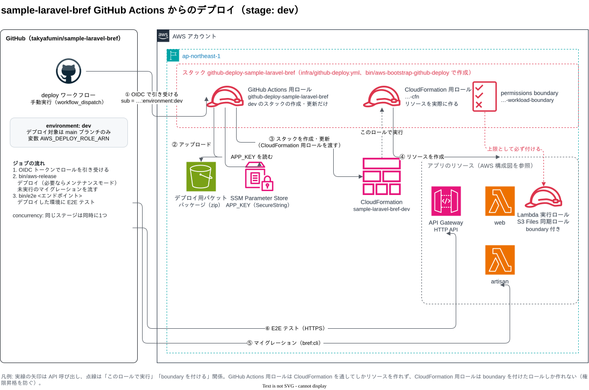

# GitHub Actions からのデプロイ

GitHub Actions から AWS の dev ステージにデプロイし、マイグレーションと、デプロイした環境に向けた E2E テストまでを行う仕組みの手順書。
検証の経緯は [#9](https://github.com/takyafumin/sample-laravel-bref/issues/9) を参照。

- ワークフロー: [.github/workflows/deploy.yml](../.github/workflows/deploy.yml)
- デプロイとマイグレーション: [bin/aws-release](../bin/aws-release)
- デプロイ用のロール: [infra/github-deploy.yml](../infra/github-deploy.yml)（作成: [bin/aws-bootstrap-github-deploy](../bin/aws-bootstrap-github-deploy)）
- アプリの AWS 構成: [aws-architecture.md](aws-architecture.md)

## 1. 全体の流れ



[github-deploy.drawio.svg](github-deploy.drawio.svg) は draw.io のデータを埋め込んだ SVG。draw.io でそのまま開いて編集できる。

1. **ロールを引き受ける:** ワークフローは environment `dev` で動き、GitHub の OIDC トークンで AWS のロール `github-deploy-sample-laravel-bref` を引き受ける。長期のアクセスキーは使わない。
2. **パッケージを上げる:** `bin/aws-release` が `bin/deploy` を呼ぶ。dev 依存を外したパッケージを作り、デプロイ用バケットにアップロードする。APP_KEY は SSM から読み、デプロイ時に解決する。
3. **スタックを更新する:** GitHub Actions のロールは、CloudFormation にスタックの作成・更新を依頼する。そのとき、CloudFormation 用のロール `github-deploy-sample-laravel-bref-cfn` を渡す。
4. **リソースを作る:** CloudFormation が、CloudFormation 用のロールでリソースを作る。CloudFormation 用のロールは、permissions boundary を付けたロールしか作れない。
5. **マイグレーション:** 未実行のマイグレーションがあれば、artisan 関数で `migrate --force` を流す（`bref:cli`）。
6. **E2E テスト:** スタックの出力 `HttpApiUrl` に向けて、`bin/e2e` で Playwright の E2E テストを実行する。

## 2. 実行のしかた

Actions → **Deploy** → **Run workflow** で、ステージ（今は `dev` だけ）を選んで実行する。

- **実行できるブランチ:** environment `dev` のデプロイ対象を `main` ブランチに限っているので、main からしか実行できない（ほかのブランチを選ぶとジョブが止まる）。
- **同時実行:** 同じステージのデプロイは同時に1つしか走らない（`concurrency`）。後から実行したものは、前のものが終わるまで待つ。
- **所要時間:** 変更がなければ数分。スタックを新しく作るときは、15分ほどかかる。
- **結果:** 実行結果の画面から environment の URL（デプロイしたエンドポイント）を開ける。E2E が失敗したときは、Playwright のトレースが artifact `playwright-test-results` に残る。

手元から同じ手順を実行するときは、次のコマンドを使う（ホストの AWS プロファイルを使う）。

```bash
bin/aws-release dev
```

## 3. デプロイとマイグレーションの判定

`bin/aws-release` は、デプロイの前に状態を見て、どの手順で進めるかを決める。

| 状態 | 手順 |
|---|---|
| スタックがない（初回） | デプロイ → マイグレーション |
| 未実行のマイグレーションがある | メンテナンスモードでデプロイ → マイグレーション → 通常のデプロイ |
| 未実行のマイグレーションがない | デプロイだけ |

- **未実行かどうかの判定:** デプロイ済みの artisan 関数で `migrate:status` を実行し、リポジトリの `database/migrations/*.php` のうち、`Ran` になっていないものを未実行とみなす。状態を読めないとき（DB がまだないなど）は、すべて未実行とみなす。
- **メンテナンスモードを使う理由:** web 関数と artisan 関数は同時に動けるので、マイグレーション中に web 関数が SQLite に書き込まないようにする。Lambda では `artisan down` は実行した環境にしか効かないので、Bref の `MAINTENANCE_MODE`（`--param="maintenance=1"`）でデプロイする。
- **マイグレーションが失敗したとき:** 20秒おいて最大3回まで試す。作成直後は S3 Files のマウントがタイムアウトすることがあるため。それでも失敗したら、メンテナンスモードのまま止まる（中途半端なスキーマで web 関数が動かないようにするため）。
- **スタックの確認に失敗したとき:** `describe-stacks` が「does not exist」以外の理由で失敗したとき（認証の期限切れなど）は、初回とみなさずに止まる。メンテナンスモードなしでマイグレーションが流れないようにするため。

## 4. 初回の準備

AWS アカウントと GitHub リポジトリごとに1回だけ行う。

### 4.1 AWS: デプロイ用のロール

管理者の認証情報で、デプロイ用のロールのスタック（`github-deploy-sample-laravel-bref`）を作る。

```bash
aws sso login --profile takyafumin
```

```bash
bin/aws-bootstrap-github-deploy
```

- **OIDC プロバイダー:** アカウントに `token.actions.githubusercontent.com` の OIDC プロバイダーがなければ、一緒に作る。あれば既存のものを使う（1つのアカウントに同じ URL のものは1つしか作れない）。
- **OIDC の subject:** リポジトリの OIDC の subject の接頭辞を `gh` で読み、パラメータ `GitHubSubjectPrefix` に渡す。このリポジトリは、オーナーとリポジトリの ID を含む immutable な subject を使っている。
- **出力:** 実行後に `GitHubDeployRoleArn`、`CloudFormationRoleArn`、`WorkloadBoundaryArn` が表示される。serverless.yml は、このスタックから CloudFormation 用ロールと boundary の ARN を読む。そのため、手元からデプロイするときにもこのスタックが要る。

アカウントレベルの S3 Block Public Access も有効にしておく（CloudFormation 用のロールはバケットポリシーを変更できるため）。

### 4.2 GitHub: environment と変数

environment `dev` を作り、デプロイ対象を `main` ブランチに限る。

```bash
gh api -X PUT repos/{owner}/{repo}/environments/dev --input - <<<'{"deployment_branch_policy":{"protected_branches":false,"custom_branch_policies":true}}'
```

```bash
gh api -X POST repos/{owner}/{repo}/environments/dev/deployment-branch-policies -f name=main -f type=branch
```

environment の変数 `AWS_DEPLOY_ROLE_ARN` に、4.1 の出力 `GitHubDeployRoleArn` を設定する。

```bash
gh variable set AWS_DEPLOY_ROLE_ARN --env dev --body "<GitHubDeployRoleArn>"
```

### 4.3 SSM: APP_KEY

ステージの APP_KEY を作る（すでにあれば何もしない）。

```bash
bin/aws-put-app-key dev
```

## 5. 権限の設計

GitHub Actions のロールが自分の権限を広げられないよう、権限を3段に分けている。

| ロール・ポリシー | 信頼する相手 | できること |
|---|---|---|
| `github-deploy-sample-laravel-bref` | GitHub の OIDC。`sub` が `repo:takyafumin@<owner-id>/sample-laravel-bref@<repo-id>:environment:dev` と完全一致するもの | dev のスタックの作成・更新と参照、テンプレートの検証、CloudFormation 用ロールの受け渡し、dev のデプロイ用バケットへのアップロード、dev の APP_KEY の読み取り、dev の関数の呼び出し |
| `github-deploy-sample-laravel-bref-cfn` | CloudFormation | アプリのスタックのリソースの作成・更新・削除。名前（`sample-laravel-bref-*`）か、スタックのタグ（`aws:cloudformation:stack-name`）で絞る |
| `github-deploy-sample-laravel-bref-workload-boundary` | （permissions boundary） | CloudFormation 用のロールが作るロール（Lambda の実行ロール、S3 Files の同期ロール）の上限 |

- **権限昇格を防ぐ:** GitHub Actions のロールは、CloudFormation を通してしかリソースを作れない。CloudFormation 用のロールは、boundary を付けたロールしか作れない。そのため、作れるロールの権限は boundary が上限になる。
- **自分自身は変えられない:** 3つのロール・ポリシーとそのスタックの名前は、どのロールが管理できる名前にも当てはまらない。
- **ほかの environment からは使えない:** environment を指定しないジョブ（PR の CI など）や、ほかの environment（Copilot coding agent が使う `copilot` など）のジョブは、ロールを引き受けられない。
- **ステージごと:** GitHub Actions のロールが触れるのは dev だけ。別のステージを GitHub Actions からデプロイするときは、そのステージ用にロールを分ける。

詳細と、絞りきれていない点（残っているリスク）は [aws-architecture.md の「デプロイ用のロール」](aws-architecture.md#デプロイ用のロール9) を参照。

## 6. うまくいかないとき

| 症状 | 原因 | 対応 |
|---|---|---|
| `Not authorized to perform sts:AssumeRoleWithWebIdentity` | OIDC トークンの `sub` が信頼ポリシーと一致しない。environment を指定していない、別の environment、リポジトリの subject の形式が変わった、など | `gh api repos/{owner}/{repo}/actions/oidc/customization/sub` で接頭辞を確かめ、`bin/aws-bootstrap-github-deploy` を再実行する |
| ジョブが environment の保護ルール（デプロイ対象のブランチ）で止まる | main 以外のブランチから実行した | main から実行する |
| `required variable APP_KEY is missing a value` | docker compose が `.env` の APP_KEY を必要とする | ワークフローの「Prepare environment」で `.env` を作っている。手元では `cp .env.example .env` と `php artisan key:generate` |
| `is not authorized to perform: ...`（`github-deploy-sample-laravel-bref-cfn` の名前で） | CloudFormation 用のロールに権限が足りない | `infra/github-deploy.yml` に権限を足し、`bin/aws-bootstrap-github-deploy` で更新する。手元から `bin/deploy dev` でも同じエラーを再現できる |
| 初回のデプロイが失敗し、スタックが `ROLLBACK_COMPLETE` のまま | GitHub Actions のロールには `DeleteStack` がない | 手元から `bin/aws-remove dev` でスタックを消してから再実行する。ロールバックで取り残された DB 用のバケット（`Retain`）が空なら、手で削除する |
| マイグレーションが `mount time out` で失敗する | スタックの作成直後は、S3 Files のマウントがタイムアウトすることがある | 自動で再試行する。3回とも失敗したら、少し待ってワークフローを再実行する（メンテナンスモードのままになっている） |
| E2E が失敗する | デプロイした環境の不具合、またはスロットリング | artifact のトレースを `npx playwright show-trace` か https://trace.playwright.dev/ で開く |

## 7. 片付け

ステージを削除するときは、手元から実行する（GitHub Actions のロールは削除できない）。

```bash
bin/aws-remove dev
```

- **ロールのスタックは最後に消す:** スタックに CloudFormation 用のロールが紐づいているので、削除もそのロールで行われる。`github-deploy-sample-laravel-bref` スタックを先に消すと、アプリのスタックを更新も削除もできなくなる。
- **ロールのスタックの消し方:** アプリのスタックをすべて消したあとで、`aws cloudformation delete-stack --stack-name github-deploy-sample-laravel-bref` を実行する。
